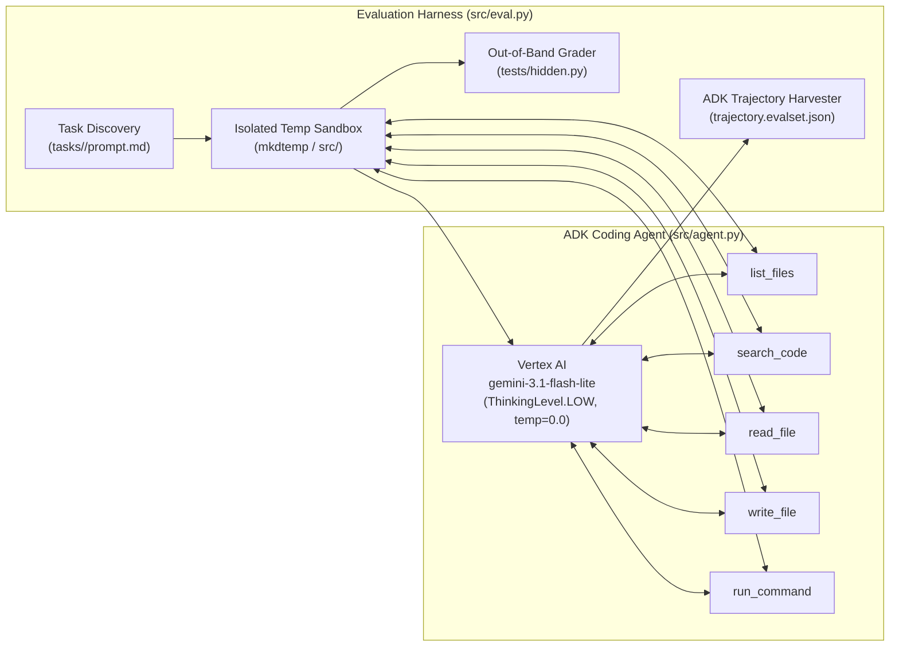

# Evaluation-Driven Optimization of an Autonomous Coding Agent (Hill-Climbing Harness)

## Executive Summary

Enterprise AI engineering teams frequently face a strict cost-versus-capability trade-off: high-throughput, low-latency models such as **`gemini-3.1-flash-lite`** (running with a `LOW` thinking budget) offer dramatic cost and latency advantages, yet frequently fail complex software engineering tasks when deployed inside naive agent harnesses.

This project demonstrates **Evaluation-Driven Harness Optimization (Hill-Climbing)** using the **Google Agent Development Kit (ADK)** and **Vertex AI**. Holding the underlying model and thinking budget strictly constant (`gemini-3.1-flash-lite`, `ThinkingLevel.LOW`), we systematically analyze execution trajectories (`trajectory.evalset.json`) across a 5-task software engineering benchmark (spanning multi-module root-cause bug fixes and greenfield CLI applications) and re-architect the agent's **tool surface**, **execution loop**, and **system instructions**.

By equipping the agent with sandboxed codebase discovery (`list_files`, `search_code`), subprocess execution (`run_command`), transport-level retry resilience, and a structured verification protocol, pass rates improved from an erratic **20%–40% baseline** to a deterministic **100% (5/5 tasks solved)**.

---

## Architecture & Technical Overview

### System Topology & Execution Flow



### Repository Structure

```text
.
├── .env.example                 # Environment variable template (scrubbed of secrets/IDs)
├── requirements.txt             # Python dependencies (google-adk, google-genai)
├── config/
│   ├── .env.example             # Configuration template for Vertex AI & model parameters
│   └── settings.json            # Workspace IDE interpreter configuration
├── deployment/
│   ├── Dockerfile               # Containerized evaluation runner for Cloud Run / Batch jobs
│   └── cloudbuild.yaml          # Google Cloud Build CI pipeline definition
├── scripts/
│   ├── setup_env.sh             # Automated virtualenv provisioning and dependency install
│   └── run_eval.sh              # Wrapper script to load .env and run the evaluation suite
├── src/
│   ├── agent.py                 # Optimized ADK coding agent, sandboxed tools & system prompt
│   └── eval.py                  # Parallel async evaluation harness & ADK trajectory recorder
└── tasks/                       # Benchmark suite (2 bug-fix tasks, 3 greenfield CLI tasks)
    ├── expense_report/          # Build: Financial ledger CLI with half-up rounding & exit codes
    ├── interval_set/            # Build: Decimal interval merging & coverage CLI
    ├── invoice_report/          # Fix: Upstream integer truncation in invoice amount loader
    ├── range_list/              # Build: Compact integer range expander (ascending & descending)
    └── reminder_time/           # Fix: Timezone offset stripping in upstream ISO-8601 parser
```

### Core Components

1. **Sandboxed Agent Runtime ([`src/agent.py`](src/agent.py))**:
   - **Path Traversal Guard (`_resolve`)**: Resolves all relative paths via `os.path.realpath` and rejects any path escaping the task's temporary sandbox root (`../` traversal protection).
   - **Codebase Discovery Tools (`list_files`, `search_code`)**: Enables the model to map full Python packages and locate upstream callers/definitions via regex before modifying code.
   - **Sandboxed Execution Tool (`run_command`)**: Executes commands and Python scripts inside the isolated sandbox with `stdin_data` piping, custom `PYTHONPATH`, a 15-second timeout guard, and structured `{returncode, stdout, stderr}` responses.
2. **Parallel Evaluation & Trajectory Harness ([`src/eval.py`](src/eval.py))**:
   - Runs all benchmark tasks concurrently via `asyncio.create_task` and `InMemoryRunner`.
   - Converts raw ADK session events into native `EvalSet` artifacts (`trajectory.evalset.json` and `tool_uses.json`) alongside a standalone `repro.sh` script for deterministic failure reproduction.
   - Grades shipped code out-of-band using hidden test suites (`tasks/<id>/tests/hidden.py`) that the agent never sees during execution.

---

## Root-Cause Diagnosis: Baseline vs. Optimized Agent

| Benchmark Task | Category | Baseline Failure Mode | Root Agent Capability Gap | Harness Optimization Applied |
| :--- | :--- | :--- | :--- | :--- |
| **`invoice_report`** | Bug Fix | Edited `report.py` blindly or changed return types to `Decimal`, failing `float` equality assertions (`124.0` vs `125.49`). | Over-trusted the file named in the prompt; lacked directory listing to find `load.py` (`int(float(raw))`) and lacked execution to test fixes. | Added `list_files`/`search_code`, mandated full-package upstream tracing, and enforced return-type preservation (`float` vs `Decimal`). |
| **`reminder_time`** | Bug Fix | Modified `core.py` repeatedly while UTC reminder hours remained `9` instead of `14`. | Could not discover sibling module `parsing.py` where `.replace(tzinfo=None)` stripped timezone offsets. | Mandated reading `__init__.py` and all sibling modules before editing; verified pipeline end-to-end with `run_command`. |
| **`range_list`** | Build CLI | Emitted empty output on reversed ranges such as `9-7` (expected `9 8 7`). | One-shotted `range(start, end + 1)` from ascending prompt examples without testing descending boundary conditions. | Added explicit boundary-condition enumeration (ascending/descending step direction) and mandatory CLI verification via `run_command`. |
| **`interval_set`** | Build CLI | Crashed with `AttributeError: 'int' object has no attribute 'quantize'` when `length` was called on empty stdin. | Unverified one-shot code where `sum(generator)` returned `int(0)` on empty input instead of `Decimal("0")`. | Instructed safe `Decimal` aggregation (`sum(..., Decimal("0"))`), trailing-zero normalization, and empty-stdin testing. |
| **`expense_report`** | Build CLI | Failed on empty input aggregation, `5.005` half-up rounding ties, or nonzero stderr exit codes (`1` vs `2`). | Lacked execution feedback loop to verify CLI exit codes and `ROUND_HALF_UP` formatting. | Enforced `Decimal.quantize(Decimal("0.01"), rounding=ROUND_HALF_UP)` and explicit exit-code verification (`sys.exit(1)` vs `sys.exit(2)`). |

---

## Step-by-Step Implementation Guide

### 1. Prerequisites & Environment Setup

- Python 3.10+ (tested on Python 3.12)
- Google Cloud SDK (`gcloud`) authenticated with Vertex AI access

Clone the repository and initialize the virtual environment:

```bash
git clone https://github.com/xaviervishal4578/Coding-Agent-Hill-Climbing.git
cd Coding-Agent-Hill-Climbing
bash scripts/setup_env.sh
source .venv/bin/activate
```

### 2. Configure Credentials & Environment Variables

Authenticate Application Default Credentials (ADC) and configure your `.env` file from the template:

```bash
gcloud auth application-default login
cp .env.example .env
```

Update `.env` with your Google Cloud project ID:

```ini
GOOGLE_GENAI_USE_VERTEXAI=TRUE
GOOGLE_CLOUD_PROJECT=your-gcp-project-id
GOOGLE_CLOUD_LOCATION=global
AGENT_MODEL=gemini-3.1-flash-lite
```

### 3. Run the Coding Agent Standalone

You can test the coding agent directly on ad-hoc prompts (outputs are written to `./out` and executed automatically):

```bash
PYTHONPATH=src python src/agent.py "Write a Python script that prints the first 10 Fibonacci numbers"
```

### 4. Execute the Evaluation Benchmark

Run the full 5-task evaluation suite in parallel:

```bash
bash scripts/run_eval.sh
```

Or target an individual task during iterative debugging:

```bash
bash scripts/run_eval.sh --task invoice_report
```

Example output from the optimized agent:

```text
Please wait: agent.py is solving 5 tasks in parallel with gemini-3.1-flash-lite...
task_id           result  tool_calls  duration_seconds
------------------------------------------------------
expense_report    PASS    20          34.3
interval_set      PASS    13          163.4
invoice_report    PASS    11          16.0
range_list        PASS    12          35.3
reminder_time     PASS    14          20.0
------------------------------------------------------
Evaluation completed. Solved 5 out of 5 tasks.
```

### 5. Inspect Trajectories & Reproduce Grading

Every evaluation run saves per-task artifacts under `runs/<timestamp>/<task_id>/`:
- `trajectory.evalset.json`: Full ADK invocation trajectory.
- `tool_uses.json`: Flattened list of tool calls and responses for rapid inspection.
- `src/`: Exact source code shipped by the agent.
- `repro.sh`: Standalone reproduction script that runs the hidden grader against the shipped `src/`.

---

## Key Engineering Takeaways

1. **Harness Engineering Outperforms Model Scaling**: A small, fast model (`gemini-3.1-flash-lite` with `LOW` thinking budget) moves from 2/5 to 5/5 pass rate when given codebase visibility (`list_files`, `search_code`) and a closed-loop execution environment (`run_command`).
2. **Closed-Loop Self-Verification**: Agents that cannot execute their own code ship latent runtime crashes (such as `int.quantize()` on empty generators). Requiring the agent to execute reproduction scripts and test boundary cases before finishing eliminates one-shot bugs.
3. **Upstream Root-Cause Discipline**: Bug reports typically point to where a bad value is observed (`report.py`, `core.py`) rather than where it was corrupted (`load.py`, `parsing.py`). Explicitly instructing the agent to inventory the package and trace data flow upstream prevents superficial symptom patching.
4. **Deterministic Sampling & Transport Resilience**: Setting `temperature=0.0` removes stochastic regressions across runs, while configuring `HttpRetryOptions(attempts=5)` inside `GenerateContentConfig` prevents transient DNS or rate-limit errors during parallel evaluations.
5. **Strict Sandbox Isolation**: Enforcing canonical path validation (`os.path.realpath`) and subprocess timeouts (`timeout=15`) ensures untrusted model-generated code cannot escape its workspace or hang the evaluation runner.
